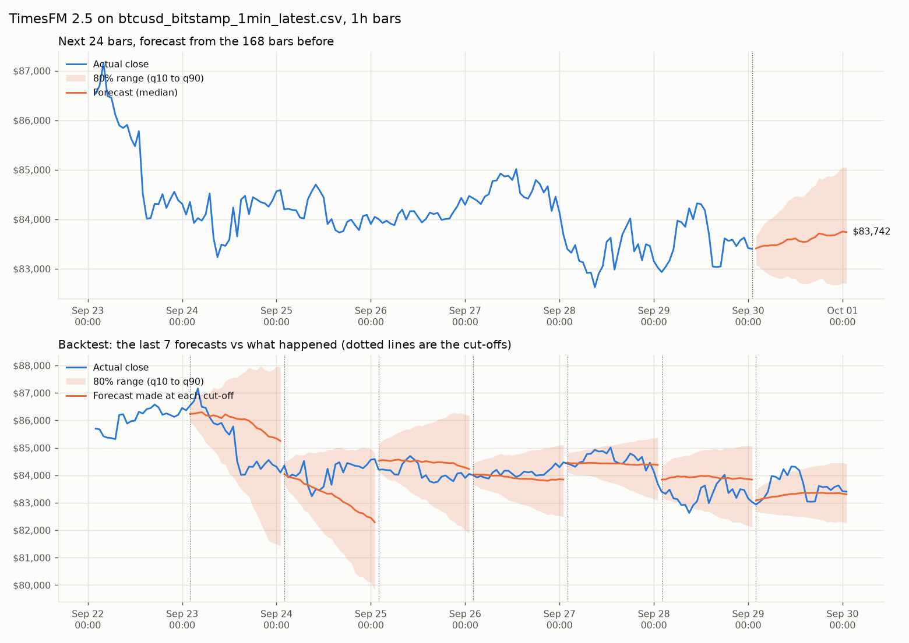

# TimesFM on BTC/USDT

Feeds the last week of BTC prices to Google's
[TimesFM 2.5](https://github.com/google-research/timesfm), a pretrained
time-series model, and checks its forecasts against what actually happened.

`btc_forecast.py` does two things per run:

- **Backtest.** At several recent cut-offs (one a day by default) it gives the
  model the 7 days before the cut-off, asks for the next 24 hours, and scores
  the answer against the real prices. It scores the same windows with a
  "the price stays where it is" forecast, because that is the baseline any
  price forecast has to beat.
- **Forecast.** Gives the model the latest 7 days and asks for the next 24
  hours: a median plus an 80% range (10th to 90th percentile).

It writes a chart and two CSVs to `results/`.

For the full evaluation (26,000 forecasts per model across 15-minute to daily
bars, volume and volatility, context lengths, trading), see
[`analysis/`](analysis/README.md); its scores are in `results/analysis/`.

## Setup

```powershell
git clone https://github.com/google-research/timesfm.git
cd timesfm
python -m venv .venv
.venv\Scripts\activate
pip install -e . "jax[cpu]" flax optax einshape orbax-checkpoint jaxtyping pandas matplotlib
```

The first run downloads the model (about 820 MB) from Hugging Face. No GPU is
needed: on 4 CPU cores it loads in about 30 s, and forecasts take under a second.

## Run

From this folder, with the TimesFM venv active:

```powershell
python btc_forecast.py                                # Binance BTCUSDT, 1h bars, last 7 days
python btc_forecast.py --backtests 200                # score 200 daily forecasts instead of 7
python btc_forecast.py --interval 15m --horizon 96    # 15-minute bars, 24 hours ahead
python btc_forecast.py --context-days 30              # give it a month of history instead
python btc_forecast.py --csv prices.csv               # your own data
```

Prices come from Binance's public market-data API (`data-api.binance.vision`,
then `api.binance.com`). No API key is needed. `--csv` takes any CSV with a
time column (`timestamp`, `open_time`, `time`, `date` or `datetime`; epoch
s/ms/µs or dates) and a `close` column, or a headerless kline dump from
[data.binance.vision](https://data.binance.vision). Minute data is resampled to
`--interval`.

`--weights` points at a local checkpoint directory instead of Hugging Face.
`--backend torch` uses the PyTorch build of the same model
(`pip install -e ".[torch]"`), but it has not been run here.

Timestamps in the output are bar open times, as on Binance: the `02:00` row
is the close of the 02:00 to 03:00 bar.

## First results (30 Sep 2026)

This container couldn't reach Binance or Hugging Face, so these runs used
[Bitstamp BTC/USD 1-minute data](https://github.com/ff137/bitstamp-btcusd-minute-data)
(updated daily; BTC/USD and BTC/USDT usually sit within a fraction of a percent of each other)
and the TimesFM 2.5 Flax checkpoint from Google's Vertex Model Garden bucket
(`gs://vertex-model-garden-public-us/timesfm/timesfm-2.5-200m-flax`).



1h bars, forecasting 24 hours ahead, scored on 200 consecutive days (mid-March
to 29 Sep 2026):

| Context | TimesFM MAE | "No change" MAE | Skill | Direction after 24h right | Actual price inside the 80% range |
|---|---|---|---|---|---|
| 7 days  | $730 | $665 | −9.7% | 103 / 200 (52%) | 76% of hours |
| 30 days | $689 | $665 | −3.6% | 96 / 200 (48%)  | 81% of hours |

The model's median forecast was, on average, *further* from the real price
than just assuming the price wouldn't move, at every lead time from 1 hour to
24 hours. It called the direction of the 24h move about as often as a coin
flip.

Its ranges are the useful part: with a 30-day context the real price landed
inside the 80% range 81% of the time, so the range is a fair estimate of how
far BTC is likely to move over the next day. It is not a signal for which
direction it will go.

## Notes

- **Why TimesFM 2.5 and not 3.0.** 3.0 is the newest release, but its weights
  are only on Hugging Face, under a
  [non-commercial licence](https://huggingface.co/google/timesfm-3.0-pytorch/blob/main/LICENSE).
  2.5 is Apache-2.0 and is the version the timesfm package loads as
  `TimesFM_2p5_200M_*`.
- **Recommended settings.** The model is compiled with the settings from the
  repo's own guide: `normalize_inputs`, the continuous quantile head,
  flip invariance, non-negative output and no quantile crossing.
